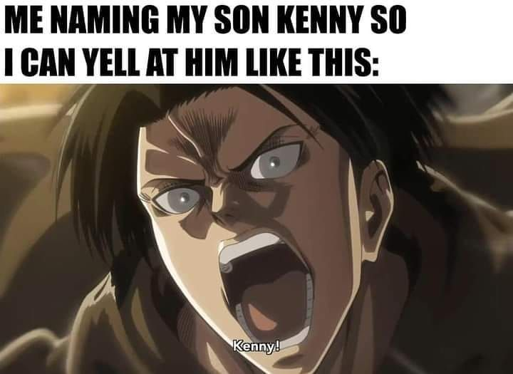

### KENNY

This is my very first attempt, at building my own LLM. 
The goal is to create a chatbot, that can hold simple conversations with users.  

To achieve this goal, I use the following source:
- **Build a Large Language Model (from Scratch) ,Sebastian Raschka (2024)**

- **Stanford lecture series -CME295 Transformers & LLMs (2026)** (planned)

<u>Model checkpoint</u> (Die einzelnen pth.File werden aus offensichtlichen Speichergründen nicht auf GitHub nicht hochgeladen.)
* Training auf die ersten 100_000 Geschichten   \& Validierung auf 20_000 Geschichten   
* Training auf die ersten 200_000 Geschichten   \& Validierung auf 20_000 Geschichten 
* Training auf die ersten 300_000 Geschichten   \& Validierung auf 20_000 Geschichten 

* Training auf die ersten 200_000 Geschichten   \& Validierung auf alle (Validierung) sGeschichten 

